<a href="https://sanaullahniazi.com">
  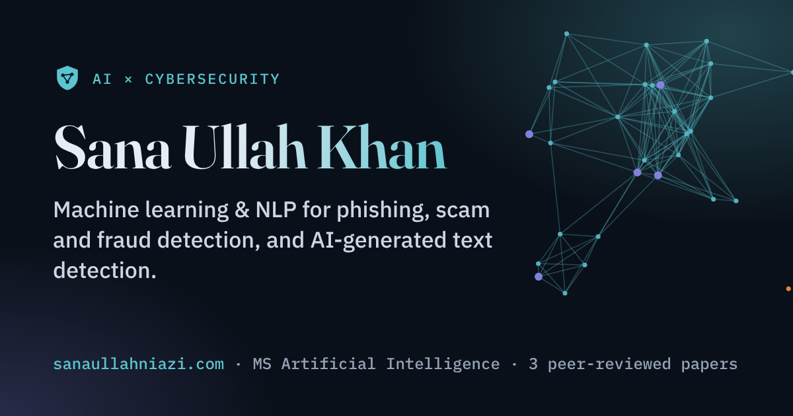
</a>

## 👋 About me

I am an early-career researcher with an **MS in Artificial Intelligence** (CGPA 3.66 / 4.00). I build machine learning and NLP models that tell real from fake: AI-generated from human text, fraud from normal transactions, scams from genuine messages. Next, I want to make AI systems themselves secure.

- 🔬 **Researching now:** AI security for multilingual users, at the intersection of AI safety and low-resource languages
- 🛠️ **Building:** a scam & phishing detector for English, Urdu and Roman Urdu messages
- 🎯 **Next:** adversarial machine learning · LLM security · AI for the SOC
- 🤝 **Open to:** Master's and PhD positions, research collaborations, and SOC / security and ML roles
- 📬 **Get in touch:** the [contact form on my website](https://sanaullahniazi.com/#contact) or [onlysanaullah@gmail.com](mailto:onlysanaullah@gmail.com)

## 🚀 Featured project: AquaPulse

<table>
  <tr>
    <td width="50%">
      <a href="https://sanaullahniazi.com/projects/aquapulse/">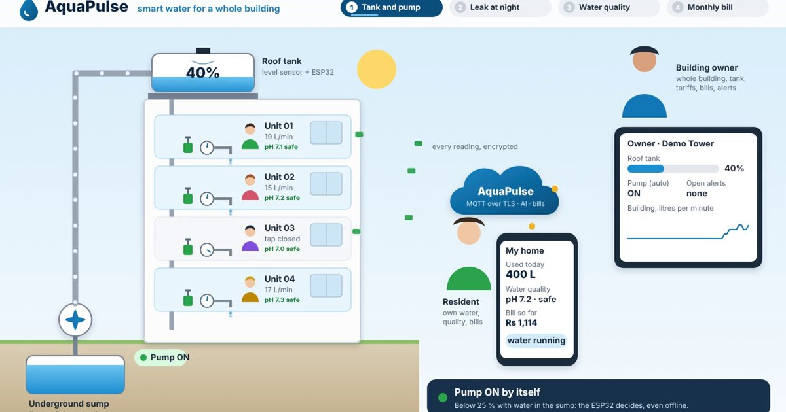</a>
    </td>
    <td width="50%">
      <b>Smart water management for apartment buildings.</b> Every home's water is metered, billed fairly and watched for leaks, from ESP32 sensors to a web app and an Android app.
        
      🤖 AI leak detection that can close a valve on its own 
      💧 Live flow, pH and temperature over encrypted MQTT 
      🧾 Slab billing in 11 currencies, with PDF bills 
      🔒 STRIDE threat model, OWASP ASVS checklist, 868 backend tests
        
      <a href="https://github.com/Sanaullah-Niazi/aquapulse"><b>Code</b></a> ·
      <a href="https://github.com/Sanaullah-Niazi/aquapulse/releases/tag/v1.0.0"><b>v1.0.0 release</b></a> ·
      <a href="https://sanaullahniazi.com/projects/aquapulse/"><b>Project page</b></a>
    </td>
  </tr>
</table>

  
  
  
  
  
  
  
  

## 🎮 Security games

Short, free games that teach you how hackers think. Play in a couple of minutes and challenge your friends.

<table>
  <tr>
    <td width="33%"><a href="https://sanaullahniazi.com/games/how-hackable-are-you/">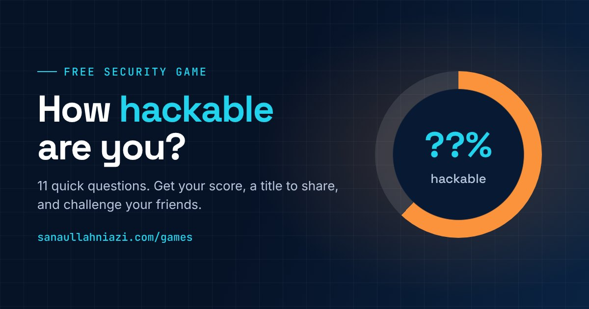</a></td>
    <td width="33%"><a href="https://sanaullahniazi.com/games/scam-or-not/">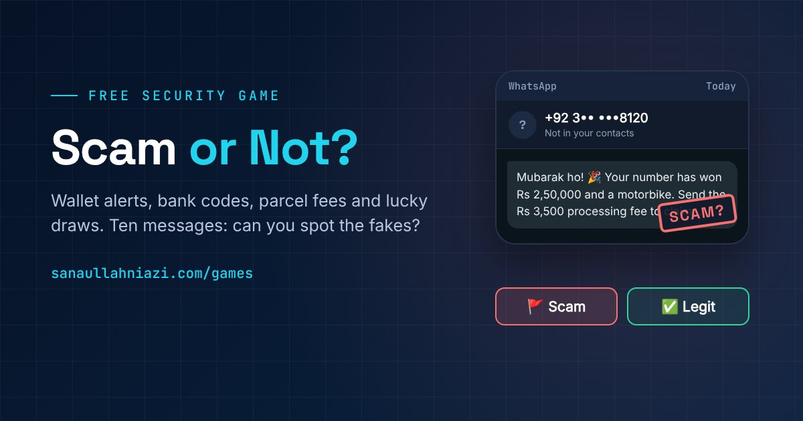</a></td>
    <td width="33%"><a href="https://sanaullahniazi.com/games/daily-hack/">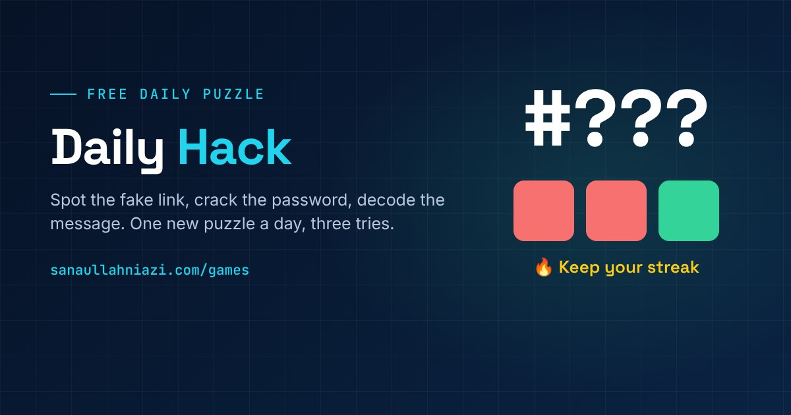</a></td>
  </tr>
  <tr>
    <td align="center"><b>How hackable are you?</b> 11 questions, 2 minutes</td>
    <td align="center"><b>Scam or Not</b> 10 real-looking messages, 3 minutes</td>
    <td align="center"><b>Daily Hack</b> A new puzzle every day</td>
  </tr>
</table>

## 🧰 25 free tools

**16 security and developer tools** plus **9 YouTube creator tools**, all free on my website.

<table>
  <tr>
    <td width="33%"><a href="https://sanaullahniazi.com/tools/website-health-checker/">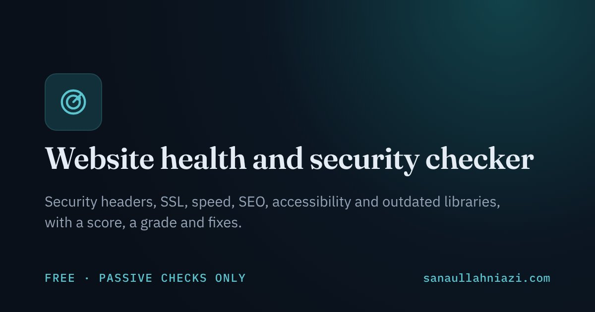</a></td>
    <td width="33%"><a href="https://sanaullahniazi.com/tools/prompt-injection-lab/">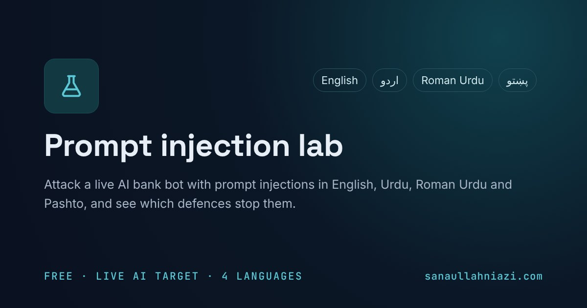</a></td>
    <td width="33%"><a href="https://sanaullahniazi.com/tools/phishing-link-checker/">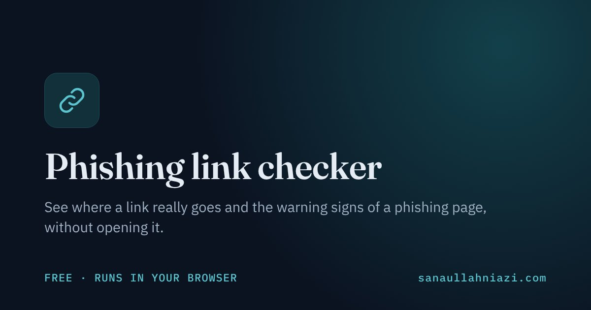</a></td>
  </tr>
  <tr>
    <td width="33%"><a href="https://sanaullahniazi.com/tools/hidden-text-detector/">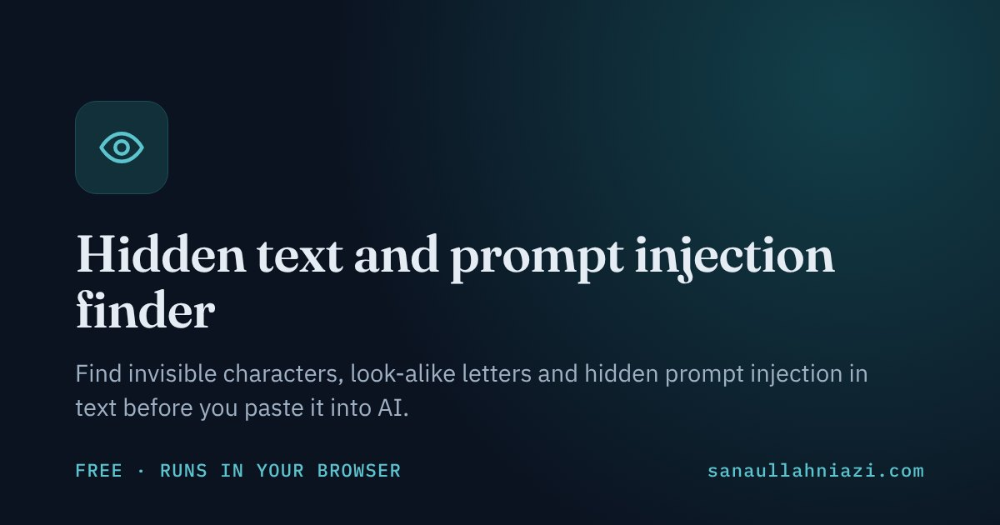</a></td>
    <td width="33%"><a href="https://sanaullahniazi.com/tools/leaked-password-checker/">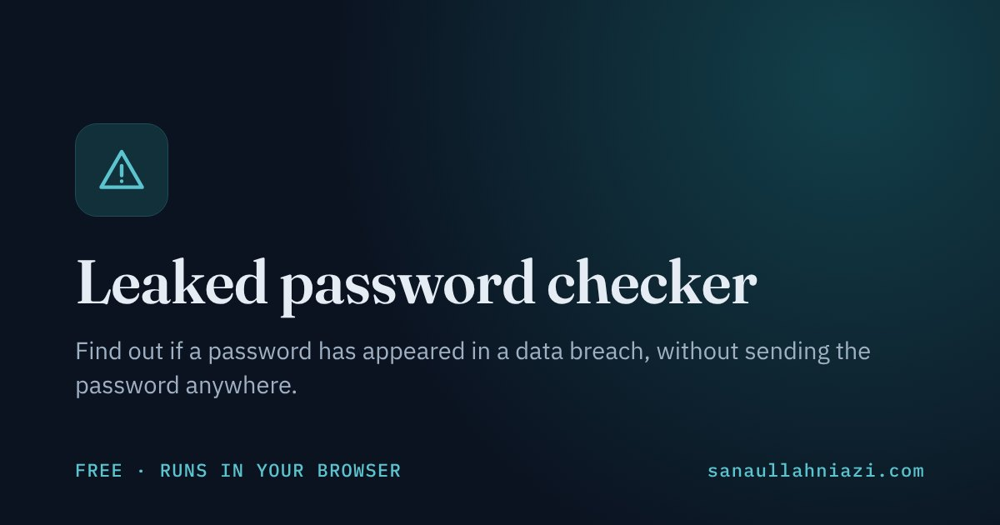</a></td>
    <td width="33%"><a href="https://sanaullahniazi.com/tools/youtube/channel-health-report/">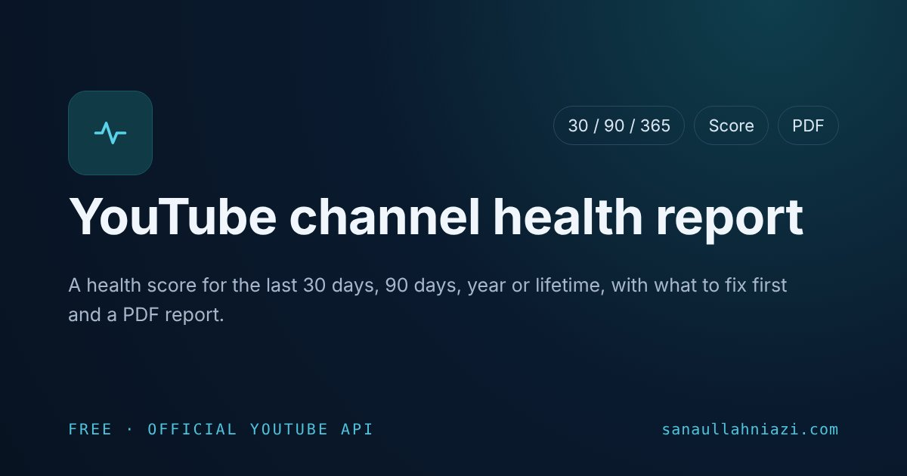</a></td>
  </tr>
</table>

- 🛡️ **Security:** website health checker, prompt injection lab (attacks in English, Urdu, Roman Urdu and Pashto), phishing link checker, leaked password checker, lookalike domain checker, photo metadata remover, password tools, hash generator and JWT decoder
- 💻 **Developer:** JSON formatter, Base64 and URL encoders, Unix timestamp converter and UUID generator
- 📺 **YouTube:** channel health report, video SEO score, outlier finder, channel comparison, keyword ideas, tag and transcript extractors, and more

<a href="https://sanaullahniazi.com/tools/"><b>See all 25 tools →</b></a>

## 🌐 More on my website

| | |
|:--|:--|
| 🗺️ **[Security roadmaps](https://sanaullahniazi.com/roadmaps/security/)** | 55 beginner-to-expert career roadmaps in 9 areas, from SOC and cloud security to offensive security, GRC and AI/ML security, plus [frameworks](https://sanaullahniazi.com/roadmaps/security/frameworks/) like NIST CSF, ISO 27001 and MITRE ATT&CK |
| 🎓 **[Learning roadmaps](https://sanaullahniazi.com/roadmaps/)** | 12 free, step-by-step learning paths, and [certification roadmaps](https://sanaullahniazi.com/roadmaps/certifications/) with real costs |
| 📰 **[Daily security news](https://sanaullahniazi.com/security-news/)** | Exploited vulnerabilities, ransomware, phishing, breaches and AI security, collected every day with a short brief |
| ✍️ **[Blog](https://sanaullahniazi.com/blog/)** | Latest: *[What 99.65% accuracy taught me about AI security](https://sanaullahniazi.com/blog/2026/what-99-percent-accuracy-taught-me/)* |
| 🌍 **Four languages** | [English](https://sanaullahniazi.com) · [اردو](https://sanaullahniazi.com/ur/) · [Deutsch](https://sanaullahniazi.com/de/) · [中文](https://sanaullahniazi.com/zh/) |

## 🔬 Research

**MS thesis:** *Advancing Deep Learning and Neural Network Techniques for AI and Human Text Classification* 
I built and compared LSTM, fine-tuned BERT, TF-IDF + BERT + LightGBM and hybrid BERT + LSTM models on a balanced dataset of about 500,000 texts.

### 📄 Publications

| Year | Paper | Role |
|:----:|-------|:----:|
| 2026 | **[AI-Driven Fraud Detection in FinTech: Strengthening Cybersecurity Against Digital Financial Scams](https://doi.org/10.63544/jbii.v5i6.116)** Journal of Business Insight and Innovation, 5(6), 72–82 | First author |
| 2026 | **[AI and Workplace Safety in the Oil and Gas Industry: Transforming Occupational Risk Assessment through Smart Safety Analytics](https://doi.org/10.65181/poms.06.01.0100)** Periodicals of Management Studies, 6(1), 46–60 | First author |
| 2026 | **[GenAI Adoption in Entrepreneurial Education and Digital Entrepreneurial Intention](https://doi.org/10.70843/ijass.2026.06107)** International Journal of Advanced Social Studies, 6(1), 82–93 | Co-author |

## 📌 Projects

| Project | What it does | Status |
|---------|--------------|:------:|
| **[AquaPulse](https://sanaullahniazi.com/projects/aquapulse/)** | Smart water management for buildings: ESP32 sensors, a web app and an Android app, with billing and AI leak detection | ✅ v1.0.0 |
| **[Scam & phishing detector](https://sanaullahniazi.com/projects/scam-phishing-detector/)** | Flags scam and phishing messages in English, Urdu and Roman Urdu | 🟡 In progress |
| **[AI-generated text detector](https://sanaullahniazi.com/projects/ai-text-detector/)** | My MS thesis: deep learning models that tell AI-generated from human-written text | ✅ Completed |

## 🛠️ Tech stack

Tools and frameworks I have used in my thesis, in AquaPulse and on my website.

  

| | |
|:--|:--|
| **💬 Languages** |         |
| **🧠 AI, ML & NLP** |              |
| **⚙️ Backend & data** |        |
| **🖥️ Web & mobile** |     |
| **📡 IoT & hardware** |     |
| **☁️ Cloud & DevOps** |       |
| **🧪 Testing** |     |
| **🛡️ Security tools** |          |

**📐 Security frameworks and standards**

- **Applied in AquaPulse:** STRIDE threat modelling and the OWASP ASVS checklist, with Argon2id passwords, two-factor login and MQTT over TLS
- **Covered in my [frameworks guide](https://sanaullahniazi.com/roadmaps/security/frameworks/):** NIST CSF 2.0, ISO/IEC 27001, CIS Controls, MITRE ATT&CK, MITRE ATLAS, OWASP Top 10, OWASP GenAI Security Project, NIST AI RMF, ISO/IEC 42001, the EU AI Act and more

| Area | Level | What I can show |
|------|-------|-----------------|
| Machine learning & NLP | Research level | MS thesis with LSTM, BERT and hybrid models |
| Threat & fraud detection | Published research | First-author paper on AI-driven fraud detection for FinTech cybersecurity |
| AI security | Current research | Multilingual AI security research and a prompt injection lab in four languages |
| SOC & blue team | Training & lab level | Cisco Junior Cybersecurity Analyst path; 3-month NAVTTC digital forensics & cyber security course (Grade A) |
| Penetration testing | Training & lab level | Cisco Ethical Hacker programme; lab work with Kali Linux, Nmap and Wireshark |

## 📰 News

- **Oct 2026** · Released [AquaPulse v1.0.0](https://github.com/Sanaullah-Niazi/aquapulse/releases/tag/v1.0.0) under the MIT licence.
- **Oct 2026** · Launched free [security games](https://sanaullahniazi.com/games/) and a [prompt injection lab](https://sanaullahniazi.com/tools/prompt-injection-lab/) on my website.
- **Oct 2026** · Scored IELTS Academic 6.5 (B2) and started learning German.
- **Jun 2026** · First-author paper on AI-driven fraud detection in FinTech [published](https://doi.org/10.63544/jbii.v5i6.116).
- **Jan 2026** · Awarded the MS in Artificial Intelligence by The Islamia University of Bahawalpur (CGPA 3.66 / 4.00).

<b>💼 Experience</b>

 

- 🏫 **Visiting Lecturer** (part-time), Department of IT, GC University Faisalabad, Layyah Campus *(Mar 2024 – Jun 2026)* 
  Taught Introduction to ICT and Computer Networks to undergraduate IT students.
- 💻 **Freelance Video Editor & Python Automation Specialist**, Upwork *(Jul 2021 – present)* 
  43 contracts, 100% Job Success Score, 1,494 logged hours. Python scripts for web scraping, data collection and automation.

<b>🎓 Education</b>

 

- **MS in Artificial Intelligence**, The Islamia University of Bahawalpur *(Nov 2023 – Jan 2026)* · CGPA 3.66 / 4.00
- **BS in Information Technology**, BUITEMS, Quetta *(Oct 2019 – Jul 2023)*
- **Diploma in Health, Safety & Environmental Engineering**, Peshawar Institute of Technical Education *(2017 – 2020)*

<b>📜 Certifications</b>

 

**Cybersecurity & digital forensics**

- Digital Forensic & Cyber Security (3-month course, Grade A), NAVTTC, Govt. of Pakistan *(Feb – May 2024)*
- Junior Cybersecurity Analyst Career Path, Cisco Networking Academy *(Oct 2024)*
- Ethical Hacker, Cisco Networking Academy *(Nov 2024)*
- Introduction to Cybersecurity, Cisco Networking Academy *(Nov 2024)*

**AI, programming & IoT**

- Programming in Python, Meta (Coursera) *(Feb 2025)*
- Advanced Chatbots with Deep Learning and Python, Packt (Coursera) *(Feb 2025)*
- AI Python for Beginners, DeepLearning.AI (Coursera) *(Mar 2025)*
- IoT for Everyone, UET Peshawar / HEC (Coursera) *(Jul 2026)*

## 📊 GitHub activity

  
  

Pakistan · <a href="https://sanaullahniazi.com">sanaullahniazi.com</a> · English · اردو · Deutsch · 中文

