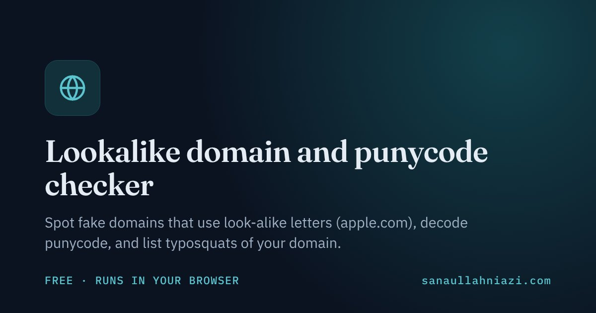
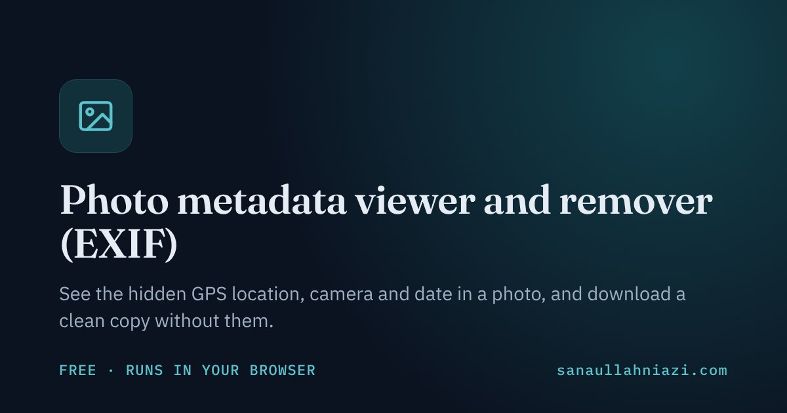

## 👋 About me

I am an early-career researcher with an **MS in Artificial Intelligence**. I build machine learning and NLP models that tell real from fake: AI-generated from human text, fraud from normal transactions, scams from genuine messages. Next, I want to make AI systems themselves secure.

- 🔬 **Now:** AI-generated text detection · phishing & scam detection · fraud detection
- 🎯 **Next:** adversarial machine learning · LLM security · AI for the SOC
- 🛠️ **Building:** a scam & phishing detector for English, Urdu and Roman Urdu messages
- 🤝 **Open to:** Master's and PhD positions, research collaborations, and SOC / security and ML roles
- 📬 **Get in touch:** use the [contact form on my website](https://sanaullahniazi.com/#contact) or email [sanaullahkhan.hse@gmail.com](mailto:sanaullahkhan.hse@gmail.com)

## 🌐 On my website

| | | |
|:--|:--|:--|
| 🛡️ **[Free security tools](https://sanaullahniazi.com/tools/)** | 15 free tools: website health and security checker, phishing link checker, leaked password checker, hidden text and prompt injection finder, and more | Free, no sign-up |
| 🗺️ **[Security roadmaps](https://sanaullahniazi.com/roadmaps/security/)** | 55 beginner-to-expert career roadmaps in 9 areas, from SOC and cloud security to offensive security, GRC and AI/ML security, plus [frameworks](https://sanaullahniazi.com/roadmaps/security/frameworks/) like NIST CSF, ISO 27001 and MITRE ATT&CK | Links checked every week |
| 🎓 **[Learning roadmaps](https://sanaullahniazi.com/roadmaps/)** | Free, step-by-step paths into computer science, web, cybersecurity, AI/ML, data and cloud, and [certification roadmaps](https://sanaullahniazi.com/roadmaps/certifications/) | Free resources only |
| 📰 **[Daily security news](https://sanaullahniazi.com/security-news/)** | Exploited vulnerabilities, ransomware, phishing, breaches and AI security, collected every day with a short brief | Updated by GitHub Actions |
| ✍️ **[Blog](https://sanaullahniazi.com/blog/)** | Latest: *[What 99.65% accuracy taught me about AI security](https://sanaullahniazi.com/blog/2026/what-99-percent-accuracy-taught-me/)* | |
| 🌍 **Four languages** | [English](https://sanaullahniazi.com) · [اردو](https://sanaullahniazi.com/ur/) · [Deutsch](https://sanaullahniazi.com/de/) · [中文](https://sanaullahniazi.com/zh/) | |

### 🧰 Featured tools

<table>
  <tr>
    <td width="33%"></td>
    <td width="33%"></td>
    <td width="33%"></td>
  </tr>
  <tr>
    <td width="33%"></td>
    <td width="33%"></td>
    <td width="33%"></td>
  </tr>
</table>

<a href="https://sanaullahniazi.com/tools/"><b>See all 15 tools →</b></a>

## 🔬 Research

**MS thesis:** *Advancing Deep Learning and Neural Network Techniques for AI and Human Text Classification* 
I built and compared LSTM, fine-tuned BERT, TF-IDF + BERT + LightGBM and hybrid BERT + LSTM models on a balanced dataset of about 500,000 texts.

### 📄 Publications

| Year | Paper | Role |
|:----:|-------|:----:|
| 2026 | **[AI-Driven Fraud Detection in FinTech: Strengthening Cybersecurity Against Digital Financial Scams](https://doi.org/10.63544/jbii.v5i6.116)** Journal of Business Insight and Innovation, 5(6), 72–82 | First author |
| 2026 | **[AI and Workplace Safety in the Oil and Gas Industry: Transforming Occupational Risk Assessment through Smart Safety Analytics](https://doi.org/10.65181/poms.06.01.0100)** Periodicals of Management Studies, 6(1), 46–60 | First author |
| 2026 | **[GenAI Adoption in Entrepreneurial Education and Digital Entrepreneurial Intention](https://doi.org/10.70843/ijass.2026.06107)** International Journal of Advanced Social Studies, 6(1), 82–93 | Co-author |

## 📌 Projects

| Project | What it does | Status |
|---------|--------------|:------:|
| **[Scam & phishing detector](https://sanaullahniazi.com/projects/scam-phishing-detector/)** | Flags scam and phishing messages in English, Urdu and Roman Urdu, the languages people in Pakistan actually receive them in | 🟡 In progress |
| **[AI-generated text detector](https://sanaullahniazi.com/projects/ai-text-detector/)** | My MS thesis: deep learning models that tell AI-generated from human-written text | ✅ Completed |
| **[IoT water management](https://sanaullahniazi.com/projects/iot-water-management/)** | BS final-year project: Arduino sensors, automatic pump control and an Android app | ✅ Completed |

## 🛠️ Skills

  

| Area | Level | What I can show |
|------|-------|-----------------|
| Machine learning & NLP | Research level | MS thesis with LSTM, BERT and hybrid models |
| Threat & fraud detection | Published research | First-author paper on AI-driven fraud detection for FinTech cybersecurity |
| AI security | Current direction | Detecting AI-generated content today; adversarial ML and LLM security next |
| SOC & blue team | Training & lab level | Cisco Junior Cybersecurity Analyst path; 3-month NAVTTC digital forensics & cyber security course (Grade A) |
| Penetration testing | Training & lab level | Cisco Ethical Hacker programme; lab work with Kali Linux, Nmap and Wireshark |

## 📰 News

- **Oct 2026** · Scored IELTS Academic 6.5 (B2) and started learning German.
- **Jul 2026** · Completed "IoT for Everyone" (UET Peshawar / HEC, Coursera).
- **Jun 2026** · First-author paper on AI-driven fraud detection in FinTech [published](https://doi.org/10.63544/jbii.v5i6.116).
- **Mar 2026** · First-author paper on AI and workplace safety in oil and gas [published](https://doi.org/10.65181/poms.06.01.0100).
- **Jan 2026** · Awarded the MS in Artificial Intelligence by The Islamia University of Bahawalpur (CGPA 3.66 / 4.00).

<b>💼 Experience</b>

 

- 🏫 **Visiting Lecturer** (part-time), Department of IT, GC University Faisalabad, Layyah Campus *(Mar 2024 – Jun 2026)* 
  Taught Introduction to ICT and Computer Networks to undergraduate IT students.
- 💻 **Freelance Video Editor & Python Automation Specialist**, Upwork *(Jul 2021 – present)* 
  43 contracts, 100% Job Success Score, 1,494 logged hours. Python scripts for web scraping, data collection and automation.

<b>🎓 Education</b>

 

- **MS in Artificial Intelligence**, The Islamia University of Bahawalpur *(Nov 2023 – Jan 2026)* · CGPA 3.66 / 4.00
- **BS in Information Technology**, BUITEMS, Quetta *(Oct 2019 – Jul 2023)*
- **Diploma in Health, Safety & Environmental Engineering**, Peshawar Institute of Technical Education *(2017 – 2020)*

<b>📜 Certifications</b>

 

**Cybersecurity & digital forensics**

- Digital Forensic & Cyber Security (3-month course, Grade A), NAVTTC, Govt. of Pakistan *(Feb – May 2024)*
- Junior Cybersecurity Analyst Career Path, Cisco Networking Academy *(Oct 2024)*
- Ethical Hacker, Cisco Networking Academy *(Nov 2024)*
- Introduction to Cybersecurity, Cisco Networking Academy *(Nov 2024)*

**AI, programming & IoT**

- Programming in Python, Meta (Coursera) *(Feb 2025)*
- Advanced Chatbots with Deep Learning and Python, Packt (Coursera) *(Feb 2025)*
- AI Python for Beginners, DeepLearning.AI (Coursera) *(Mar 2025)*
- IoT for Everyone, UET Peshawar / HEC (Coursera) *(Jul 2026)*

## 📊 GitHub activity

  
  

Pakistan · <a href="https://sanaullahniazi.com">sanaullahniazi.com</a> · English · اردو · Deutsch · 中文

